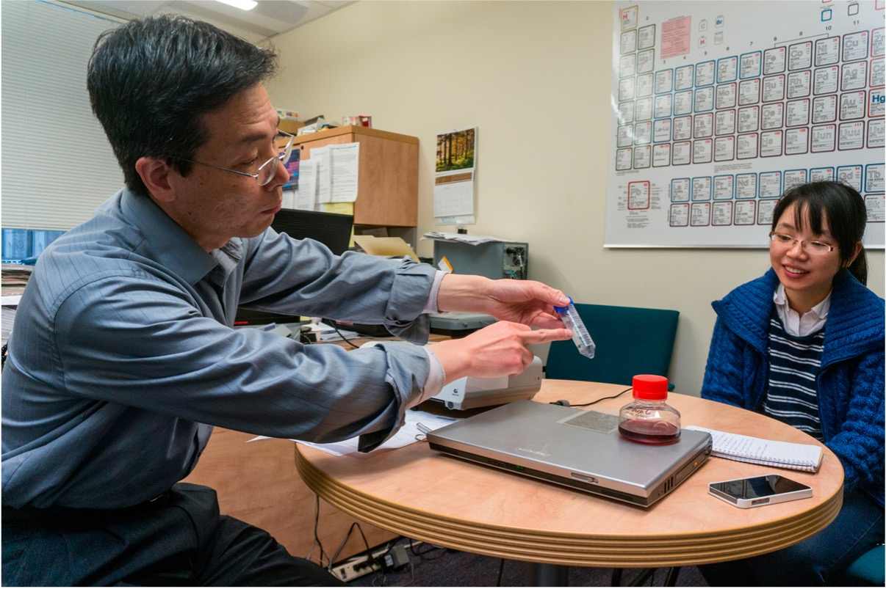
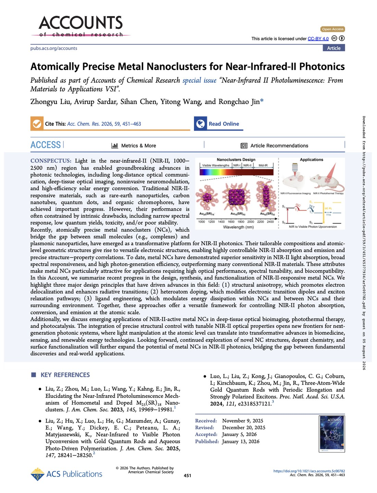

# Rongchao Jin Research Group Website — Editing Manual

Plain HTML, one stylesheet, one small script. No build tools, no fees.
Open any file in a text editor (VS Code recommended), edit, save, refresh the browser.

**The method for every edit below:** open the named file, press **Cmd+F**, paste
the "search for" text, and change what you find.

**To preview:** double-click `index.html`. Everything works straight from the folder.

---

## What is where

| File | What it is |
|---|---|
| `index.html` | Home |
| `about.html` | About RJ |
| `current-members.html`, `alumni.html`, `group-photos.html` | Group Members menu |
| `research-approach.html`, `instruments.html`, `funding.html` | Research menu |
| `publications.html`, `news.html`, `links.html` | The other three menu items |
| `assets/common.js` | Header, menu and footer for **every** page (edit once) |
| `assets/style.css` | All colours, fonts, sizes and layout |
| `images/` | Every picture on the site |

---

## PART 1 — IMAGES

To change a picture, **replace the file in `images/` with a new one of the same
name** (capitals matter: `GH.jpg` is not `gh.jpg`), then refresh. No code edits.

| What you see | File(s) | Good size |
|---|---|---|
| Logo in the header | `homeicon2.png` | square, 150×150 or more |
| Icon in the browser tab / phone home screen | `favicon.png`, `apple-touch-icon.png` | 64×64 and 180×180 |
| Homepage picture reel | `banner1.jpg` … `banner5.jpg` | any shape, about 1000 px tall |
| Homepage research tiles | `theme-1.jpg`, `theme-2.jpg` (shared with the Research page) | wide, about 2:1 |
| Homepage highlighted papers | `pub-1.jpg` … `pub-4.jpg` | portrait (3:4), about 1000 px wide |
| Prof. Jin's photo | `RJ.jpg` | square, 600×600 or more |
| Member photos | `GH.jpg`, `AB.jpg`, `UT.jpg`, `AM.jpeg`, `AS.jpeg`, `SC.jpg`, `WJ.jpg`, `EH.jpeg` | square, 600×600 or more |
| Research figures | `theme-1.jpg` … `theme-4.jpg` | wide, about 2:1, 1400 px wide or more |
| Group photos | `yw-defense.jpg`, `group-2026.jpeg`, `grc-2026.jpg`, `ll-defense.jpg`, `group-2024.jpg`, `zl-defense.jpg`, `ISMPC2024.jpg` | landscape, 2000 px wide |
| Instruments | `instr-fls1000.png`, `instr-uv3600.png`, `instr-ta.png`, `instr-cryostat.png` | landscape 4:3 |
| Funding logos | `funder-psu.png`, `funder-nsf.png`, `funder-doe.png`, `funder-kaufman.png`, `funder-cmu.png` | transparent PNG, no empty margin |
| Small pictures beside publications | `pubtoc-1.png`, `pubtoc-2.png` | square, 400×400 |

The grey person outlines and the "Photo coming soon" / "TOC graphic" tiles are
placeholders. Replace the file and they are gone.

**If your new file has a different name or ending** (say `.png` instead of `.jpg`):
search the old file name in the page and change the `src="images/..."` to the new name.

**Keep pictures web-sized.** Before adding a photo, shrink it to about 2000 px wide
and save it as JPEG. On a Mac: open in Preview → Tools → Adjust Size → width 2000 →
File → Export → JPEG, quality about 80%. A phone photo then weighs under 1 MB
instead of 5–40 MB. This matters twice: the page loads quickly on a phone, and
Cloudflare Pages refuses any single file larger than 25 MB.

**Member photos:** several current ones are only 200×200, which looks soft at the
size they are shown. Replace them with 600×600 versions when you can.

---

## PART 2 — HEADER, MENU & FOOTER (`assets/common.js`)

One file feeds all eleven pages. At the top is a block called `SITE`:

```js
const SITE = {
  groupName: "Rongchao Jin Research Group",
  subtitle:  "Department of Chemistry · Penn State University",
  email:     "rj321@gmail.com",
  phone:     "[Phone number]",
  office:    "408, Benkovic Building",
  ...
  twitter:   "#",
  recruitHeading: "Interested in our group? Send us an email!"
};
```

Change a value, save, refresh: it changes everywhere.

- **A line that is still a `[placeholder]`, `"#"` or empty is left out of the
  footer.** So the telephone line and the X/Twitter link appear by themselves as
  soon as you fill them in.
- **Menu:** search `HEADER_HTML`. Each item is one `<li><a href="page.html">Label</a></li>`
  line. Copy a line to add a page; the two `class="dropdown"` items are the folders.
- **Band and footer wording:** search `FOOTER_HTML`.
- The copyright year updates itself.
- Everything under the line `NO NEED TO EDIT BELOW THIS LINE` is machinery. Leave it.

---

## PART 3 — HOMEPAGE (`index.html`)

- **Small line above the title** — search: `Penn State University · Department of Chemistry`
- **Big title** — search: `<h1>Rongchao Jin Research Group</h1>`
- **Tagline** — search: `Atomically precise metal nanoclusters — synthesis`
- **The two buttons** — search: `btn btn-solid` and `btn btn-ghost`

**Picture reel** — search: `banner-car`. Each picture is one line:

```html
<div class="slide"></div>
```

Copy a line to add a picture, delete a line to remove one, reorder lines to
reorder pictures. Any shape works: every picture is shown whole, all at one
height. The `alt` text is read out to blind visitors and is the caption when the
picture is enlarged, so write what the picture shows. The reel moves on by itself
every 6 seconds until the visitor touches it; visitors can swipe, drag, use the
arrows, or click a picture to see it large.

**Research tiles** — search: `Synthesis of APNCs &amp; Quantum Rods`. Each tile is
one `<div class="card">` with a picture line (`card-figure`), a title (`<h3>`), a
sentence (`<p>`) and a link (`cardlink`). To show a third tile, copy a whole card
and change `class="cards two"` to `class="cards"`.

**Recent Research Highlights** — search: `pubpics`. Each paper is one block:

```html
<a class="pubpic" href="https://doi.org/10.1021/acs.accounts.5c00782" target="_blank" rel="noopener">
  
  <span class="cap">Acc. Chem. Res., 2026</span>
  <span class="cap-title">Atomically Precise Metal Nanoclusters for Near-Infrared-II Photonics</span>
</a>
```

`href` is where a click goes, `cap` is the journal and year, `cap-title` the title.
Papers 3 and 4 open the paper itself. Papers 1 and 2 still go to
`publications.html`; paste their DOI links in the same way.

**Contact form** — search: `contact-form`. As delivered, "Send message" opens the
visitor's own e-mail app with the message written and addressed to the e-mail in
`common.js`. To have messages delivered directly instead: make a free account at
formspree.io, create a form, and replace `YOUR_FORM_ID` with its ID. Messages then
arrive in the inbox of the address you signed up with.

---

## PART 4 — ABOUT (`about.html`)

- **Line under the name** — search: `Eberly Family Distinguished Chair`
- **Biography** — search: `Rongchao Jin is a Professor of Chemistry` and
  `His research involves the intertwining`
- **CV link** — search: `Full CV (PDF)`. Put `cv.pdf` in the site folder and change
  `href="#"` to `href="cv.pdf"`. Until then the link goes nowhere.
- **Positions table** — search: `Education &amp; positions`. One row is one
  `<tr><td>years</td><td>position</td><td>institution</td></tr>` line.
- **Awards / invited talks** — search: `Selected awards` or `Recent invited talks`.
  One entry is one line:
  `<li class="news-item"><span class="date mono">2015</span><p>Text</p></li>`

---

## PART 5 — CURRENT MEMBERS (`current-members.html`)

Every person is one block:

```html
<div class="person">
  <div class="avatar"></div>
  <h3>Dr. Guiying He</h3>
  <p class="email">gxh5312@psu.edu</p>
  <div class="role">Postdoc</div>
  <div class="affil">Penn State University</div>
  <div class="dates">Fall 2024 –</div>
</div>
```

- **Edit** — Cmd+F the name, change the lines.
- **Add** — copy a whole block into the right `<div class="people-grid">`, edit it,
  put the photo in `images/`.
- **Remove / move** — delete the block, or cut and paste it into another section.
- The e-mail address becomes a clickable link by itself. Leave it as plain text.
- A second `<div class="affil">` line is fine (used for "co-advised by").
- **Section headings** — search: `Postdoctoral Researchers</h2>` and so on.

---

## PART 6 — ALUMNI (`alumni.html`)

```html
<div class="alum">
  <div class="nm">Dr. Lianshun (Evan) Luo</div>
  <div class="pos">Postdoctoral Researcher</div>
  <div class="pos">Northwestern University</div>
  <div class="yr">Graduated 2025</div>
</div>
```

Copy a block to add someone, delete it to remove. One or two `pos` lines both
work; the `yr` line is optional.

---

## PART 7 — RESEARCH APPROACH (`research-approach.html`)

- **Introduction** — search: `Our group works at the size regime`
- **A theme** — search its heading, e.g. `Ultrafast transient absorption`. You can
  edit the small label (`eyebrow`), the `<h2>`, the paragraph and the `cite` line.
- **Theme 4 is still a placeholder** — search: `[Fourth research direction]`
- **Picture left or right** — `class="research-section rev"` puts the picture on
  the left; without `rev` it is on the right.
- **Add a theme** — copy a whole `<section class="research-section" ...> … </section>`
  block, give it a new `id="theme-5"`, point the `src` at a new picture.
- Figures are always shown whole (never cropped) in equal frames. Wide figures
  (about 2:1) fill the frame best. Visitors can click a figure to enlarge it.

---

## PART 8 — INSTRUMENTS (`instruments.html`)

```html
<div class="inst">
  
  <div class="inst-body">
    <h3>Edinburgh FLS1000</h3>
    <p>One-line description.</p>
  </div>
</div>
```

Replace the four `instr-*.png` files with real photos (same names). To add an
instrument, copy a whole block. Photos are cropped to a 4:3 box, so landscape
photos with the instrument in the middle work best.

## PART 9 — FUNDING (`funding.html`)

Logos only. Each is one line inside `<div class="logo-showcase">`:

```html

```

Add, remove or reorder lines. Logos are shown at one height, so crop away any
empty margin around a logo before adding it, or it will look small.

## PART 10 — PUBLICATIONS (`publications.html`)

**Add a paper** — search: `year-divider">2026` and paste this directly under the
`<ul class="pub-list">` that follows:

```html
<li class="pub">
  <span class="pub-year">·</span>
  <div>
    <div class="pub-title">Title of the paper</div>
    <div class="pub-authors">A. Author, B. Author, <strong>R. Jin</strong></div>
    <div class="pub-meta"><span class="journal">Journal Name</span> 2026, 148, 1234–1245 · <a href="https://doi.org/10.xxxx/xxxxx">link</a></div>
  </div>
</li>
```

- **New year** — copy a `<div class="year-divider">2026</div>` plus the
  `<ul class="pub-list"> … </ul>` after it, change the year.
- **Remove a paper** — delete its whole `<li class="pub"> … </li>` block.
- **Search box, paper count and the row of year buttons build themselves** from
  whatever is in the list. Nothing to maintain.
- **Small picture beside a paper** — change `<li class="pub">` to
  `<li class="pub with-toc">` and add, right after the `pub-year` line:
  ``
- **Automatic list from ORCID (optional)** — search: `const ORCID_ID = ""` and put
  the ORCID iD between the quotes. The newest papers then load from ORCID and the
  hand-kept list is hidden.

## PART 11 — NEWS (`news.html`)

One item is one line; newest at the top:

```html
<li class="news-item"><span class="date mono">August 2026</span><p>Text, with <strong>names</strong> and <a href="https://...">links</a>.</p></li>
```

## PART 12 — LINKS (`links.html`)

Three panels of equal height. Each entry is one line:

```html
<li><a href="https://www.psu.edu">Penn State University</a></li>
```

- The Collaborations list scrolls inside its panel, so it can be as long as you like.
- An entry whose link is still `href="#"` shows as plain dark text. Put in a real
  address and it turns into a blue link.
- **Blank space between two groups of names:** `<hr class="list-gap">` on its own line.

---

## PART 13 — LOOK & FEEL (`assets/style.css`)

**Font — two lines, both at the very top, both marked `[FONT]`.**
Line 1 downloads the font; line 2 names it. To switch to, say, Lato:
replace `Montserrat` with `Lato` in both lines. If the new font does not appear,
it lacks one of the listed weights: shorten the end of line 1 to `:wght@400;700`.

**Colours — the `:root` block just below the font lines.**

| Name | Now | Used for |
|---|---|---|
| `--navy` | `#001E44` Nittany Navy | headings, title bands, footer |
| `--blue` | `#1E407C` Beaver Blue | links, small labels |
| `--sky` | `#96BEE6` Pugh Blue | accents on navy |
| `--ink` / `--muted` | dark / grey | body text / secondary text |
| `--wash` | pale blue-grey | pale section backgrounds |

Change a value, save, refresh: the whole site follows.

**Sizes** — search for the name:

- `--maxw` — width of the page content (1160px)
- `--reel-h` — height of the homepage picture reel
- `.people-grid` — `minmax(210px` sets member photo size (bigger number = bigger photos, fewer per row)
- `.avatar {` — `border-radius: var(--radius)` gives rounded squares; `50%` gives circles
- `.links-cols .card {` — `height: 23rem` is the height of the three Links panels
- `.logo-showcase img {` — the `170px` is the largest logo height

---

## PART 14 — ADDING A NEW PAGE

Copy `news.html`, rename the copy (e.g. `teaching.html`), change the `<title>`,
the `<h1>` and the content, then add it to the menu in `assets/common.js`.
Every page has the same skeleton:

```html
<div id="site-header"></div>
<div class="page-head">
  <div class="wrap">
    <h1>Page title</h1>
    <p>Optional one-line description.</p>
  </div>
</div>
<section class="block">
  <div class="wrap">
    … content …
  </div>
</section>
<div id="site-footer"></div>
<script src="assets/common.js"></script>
```

---

## PART 15 — GOING LIVE

**Cloudflare Pages (free), drag and drop**

1. dash.cloudflare.com → **Workers & Pages** → **Create application** → **Get started**
   → **Drag and drop your files**.
2. Give the project a name, drag this whole folder in, **Deploy site**.
   The site is live at `your-project.pages.dev`.
3. **Custom domain:** in the project, Custom domains → Set up a domain → type your
   domain. If the domain was bought at Cloudflare this is one click.
4. **Updating:** open the project → **Create a new deployment** → drag the folder again.

Limits: 1,000 files and 25 MB per file. This folder is about 60 files and 7 MB.

**GitHub Pages (free) also works:** new public repository → upload the folder →
Settings → Pages → branch `main`, folder `/ (root)`.

Either way, keep the master copy of the folder on your computer and a backup
somewhere else. The host only ever holds a copy.

---

## Golden rules

1. Back up the folder before a big edit.
2. File names are case-sensitive on the web.
3. Every tag you open must be closed: `<div>` … `</div>`, `<a ...>` … `</a>`.
   When copying a block, copy from its opening tag to its matching closing tag.
4. Save (Cmd+S), then refresh the browser (Cmd+R). If a page breaks, undo
   (Cmd+Z) until it works again.
